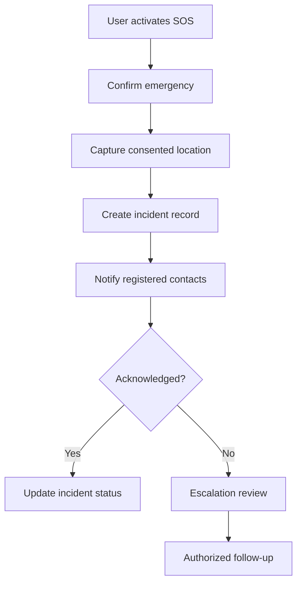
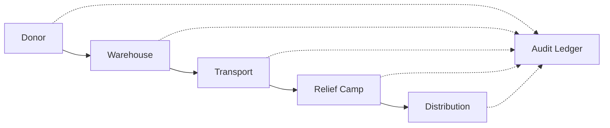
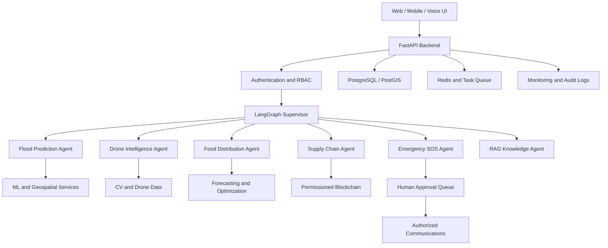

# 🌊 Kerala Flood Relief Coordination Agent

### Agentic AI • Generative AI • Machine Learning • Computer Vision • Blockchain • Disaster Response

**An intelligent, human-supervised disaster management platform designed for flood prediction, emergency SOS, rescue coordination, AI drone surveillance, relief supply traceability and food distribution optimization.**

**Status:** In Development — Proposed Architecture  
**Portfolio Target:** 10/10  
**Domain:** Disaster Management, Emergency Response, Humanitarian Logistics

---

## Project Overview

Kerala Flood Relief Coordination Agent combines machine learning, deep learning, geospatial analytics, retrieval-augmented generation (RAG), multi-agent AI and real-time communication to support flood preparedness and relief operations.

The platform is designed for citizens, volunteers, rescue coordinators, shelter managers and authorized disaster-response teams.

### Core Features

- Flood prediction and risk mapping
- Real-time SOS reporting and human-reviewed emergency prioritization
- Family and friend emergency calls, SMS and WhatsApp alerts
- Multilingual voice SOS in Malayalam, English, Hindi and Tamil
- Human-supervised AI drone surveillance
- Satellite and drone image analysis
- Rescue-team and shelter coordination
- Blockchain-based relief supply traceability
- AI food, water and medicine demand forecasting
- Relief inventory, warehouse and delivery optimization
- Advanced RAG disaster information chatbot
- Live operational dashboards and notifications

---

## 1. Multi-Agent AI Architecture

A LangGraph supervisor coordinates specialized agents.

| Agent | Responsibilities |
|---|---|
| Supervisor Agent | Orchestration, task routing and workflow management |
| Flood Prediction Agent | Flood-risk classification and forecasting |
| SOS Triage Agent | Emergency request classification for human review |
| Rescue Agent | Rescue resource recommendations |
| Emergency Call Agent | Consent-based family/friend alerts and call requests |
| Drone Intelligence Agent | Drone imagery analysis and surveillance recommendations |
| Shelter Agent | Shelter capacity and availability |
| Medical Support Agent | Routes medical assistance requests to authorized responders |
| Food Distribution Agent | Food demand and stock planning |
| Supply Chain Agent | Warehouse, transport and delivery optimization |
| Blockchain Audit Agent | Relief supply transaction verification |
| Geospatial Agent | Flood zones, roads and locations |
| Communication Agent | Multilingual notifications |
| RAG Knowledge Agent | Source-grounded disaster information |
| Verification Agent | Evidence checks, confidence and audit validation |

All safety-critical operational actions require appropriate human authorization.

---

## 2. Emergency Calling and Family/Friend Alerts

### Features

- One-tap SOS button.
- User-managed emergency contact list.
- Emergency calling to registered family and friends.
- SMS and WhatsApp emergency messages.
- Optional GPS location sharing.
- Temporary location-sharing links.
- Call and message delivery status.
- Contact acknowledgment tracking.
- Retry and escalation when contacts do not respond.
- Malayalam, English, Hindi and Tamil message templates.
- False-alarm cancellation.
- Duplicate notification prevention.
- Consent, privacy and audit controls.

### Proposed Emergency Workflow



**Safety:** The system must not impersonate emergency authorities, make uncontrolled calls or automatically dispatch rescue services without authorized integration.

---

## 3. AI Drone Flood Surveillance

### Proposed Features

- Drone mission planning and operator approval.
- Live aerial video ingestion.
- Floodwater segmentation.
- Road obstruction detection.
- Potential stranded-person detection.
- Geotagged image and video analysis.
- Thermal imagery support where compatible hardware is available.
- Flood-area mapping.
- Drone battery and connectivity monitoring.
- Human-reviewed rescue observations.
- Drone mission logs and evidence storage.

### Proposed Models and Tools

| Component | Technology |
|---|---|
| Object detection | YOLO |
| Flood segmentation | U-Net, SegFormer |
| Video analysis | OpenCV, PyTorch |
| Drone integration | MAVSDK, PX4 |
| Robotics middleware | ROS2 |
| Mapping | PostGIS, GeoPandas |
| Simulation | Gazebo / PX4 SITL |

Drone flight and surveillance must comply with applicable permissions, privacy requirements and airspace restrictions.

---

## 4. Blockchain Relief Supply Chain

### Purpose

Provide auditable tracking of humanitarian relief materials across donors, warehouses, transport vehicles and distribution centers.

### Features

- Donation registration.
- Food and medicine batch tracking.
- QR-coded inventory.
- Warehouse stock transfers.
- Authorized shipment handoffs.
- Relief camp delivery confirmation.
- Duplicate transaction detection.
- Tamper-evident audit history.
- Supply expiration tracking.
- Donor transparency dashboards.
- Reconciliation of missing or damaged stock.

### Supply Chain Workflow



**Technology:** Hyperledger Fabric or a permissioned EVM-based ledger.

Personal information, exact beneficiary locations and sensitive documents remain off-chain. Blockchain records do not independently prove that a physical delivery occurred; authorized verification is still necessary.

---

## 5. AI Food and Essential Supplies Distribution

### Features

- Shelter food-demand forecasting.
- Drinking-water demand estimation.
- Medicine and essential-supply inventory.
- Family-size and shelter-occupancy planning.
- Stock shortage prediction.
- Expiration and spoilage monitoring.
- Warehouse inventory dashboards.
- Transport capacity optimization.
- Delivery route recommendations.
- Distribution status tracking.
- Relief supply cost analytics.
- Human-reviewed allocation recommendations.

### ML and Optimization

- XGBoost and LightGBM for demand forecasting.
- Time-series models for changing shelter demand.
- Google OR-Tools for vehicle routing and allocation.
- PostGIS for geographic queries.
- MLflow for model experiments and evaluation.

Allocation decisions should preserve equitable access and account for vulnerable populations.

---

## 6. Flood Prediction and Geospatial AI

- Rainfall and river-level forecasting.
- Flood-risk classification.
- Satellite imagery processing.
- Floodwater segmentation.
- Road accessibility analysis.
- Historical flood pattern analysis.
- Interactive flood maps.
- Prediction confidence and uncertainty.
- Data freshness monitoring.

**Proposed models:** Random Forest, XGBoost, LSTM, U-Net and SegFormer.

---

## 7. Advanced RAG Disaster Knowledge Assistant

The platform includes a multilingual RAG assistant designed to retrieve verified disaster-related information.

### Pipeline

Document ingestion → Semantic chunking → Embeddings → Hybrid BM25/vector search → Reranking → LLM → Citation-grounded response.

Potential knowledge sources include official publications and advisories from IMD, CWC and KSDMA, subject to data access and freshness verification.

### AI Capabilities

- Disaster preparedness Q&A.
- Shelter information retrieval.
- Relief guidelines.
- Multilingual responses.
- Source citations.
- Tool calling.
- Human escalation for uncertain or safety-critical questions.

---

## 8. Real-Time Relief Dashboard

Planned dashboard modules:

- Live flood-risk map.
- SOS incident queue.
- Emergency contact notification status.
- Drone surveillance observations.
- Rescue and shelter resources.
- Food and medicine inventory.
- Blockchain shipment history.
- Supply delivery progress.
- AI model monitoring.
- Agent workflow status.
- Audit logs and role-based access.

---

## 9. Proposed Technology Stack

| Layer | Technologies |
|---|---|
| Programming | Python, SQL, TypeScript |
| Frontend | React, Next.js, Tailwind CSS |
| Backend | FastAPI, Pydantic, WebSocket |
| GenAI | OpenAI, Gemini, Hugging Face |
| Agents | LangGraph, LangChain |
| RAG | BM25, FAISS/pgvector, rerankers |
| ML/DL | Scikit-learn, XGBoost, PyTorch |
| Computer Vision | YOLO, OpenCV, U-Net, SegFormer |
| Drone/Robotics | ROS2, PX4, MAVSDK |
| Geospatial | GeoPandas, PostGIS, Rasterio |
| Blockchain | Hyperledger Fabric |
| Optimization | Google OR-Tools |
| Communications | Twilio/Exotel, WhatsApp Business API, FCM |
| Databases | PostgreSQL, Redis |
| MLOps | MLflow, DVC, Evidently |
| Cloud/DevOps | AWS, Docker, GitHub Actions |
| Observability | Prometheus, Grafana, OpenTelemetry |

---

## 10. System Architecture



---

## 11. Proposed Repository Structure

```text
kerala-flood-relief-agent/
├── README.md
├── LICENSE
├── .env.example
├── requirements.txt
├── docker-compose.yml
├── backend/
│   └── app/
│       ├── main.py
│       ├── api/
│       ├── agents/
│       │   ├── supervisor_agent.py
│       │   ├── flood_prediction_agent.py
│       │   ├── sos_triage_agent.py
│       │   ├── emergency_call_agent.py
│       │   ├── drone_intelligence_agent.py
│       │   ├── food_distribution_agent.py
│       │   ├── supply_chain_agent.py
│       │   └── rag_knowledge_agent.py
│       ├── ml/
│       ├── vision/
│       ├── drone/
│       ├── blockchain/
│       ├── logistics/
│       ├── rag/
│       ├── services/
│       ├── security/
│       ├── database/
│       └── models/
├── frontend/
│   ├── app/
│   ├── components/
│   └── public/
├── datasets/
├── notebooks/
├── evaluation/
├── tests/
├── monitoring/
├── infrastructure/
├── docs/
└── scripts/
```

---

## 12. Evaluation and Benchmarks

| Module | Metrics |
|---|---|
| Flood classification | Precision, Recall, F1, PR-AUC |
| Water-level forecasting | MAE, RMSE |
| Flood segmentation | IoU, Dice |
| Drone object detection | Precision, Recall, mAP |
| SOS triage | Recall, false-negative rate |
| Emergency notifications | Delivery success, acknowledgment latency |
| Food demand forecasting | MAE, WAPE |
| Supply optimization | Fulfillment rate, delivery delay, constraint violations |
| Blockchain | Transaction confirmation time, audit consistency |
| RAG | Recall@K, faithfulness, citation accuracy |
| Multi-agent orchestration | Task completion, failures, approval compliance |
| API performance | p50/p95 latency, error rate |

**Measured results:** Pending implementation and reproducible testing.

---

## 13. Security and Responsible AI

- OAuth2 and role-based access control.
- Explicit consent for location sharing.
- Emergency contact permission management.
- Encrypted communications.
- Secure file uploads.
- Audit trails and incident logging.
- Data minimization and retention policies.
- Prompt-injection defenses.
- Human-in-the-loop emergency decisions.
- Drone flight authorization and privacy safeguards.
- Off-chain storage of sensitive beneficiary data.
- Synthetic-data simulation for testing.

**Disclaimer:** This is an in-development portfolio project. It is not an officially certified emergency-response platform. Real-world rescue, medical and flight operations require trained personnel, appropriate authorization and validated integrations.

---

## 14. Development Roadmap

**Phase 1 — Foundation:** FastAPI, authentication, database, dashboard, synthetic flood/SOS simulation.

**Phase 2 — Core AI:** Flood forecasting, geospatial maps, advanced RAG and LangGraph agent orchestration.

**Phase 3 — Emergency Communications:** Opt-in family/friend alerts, message acknowledgment, multilingual voice SOS and escalation.

**Phase 4 — Drone Intelligence:** Video ingestion, CV detection, simulated drone missions and human verification.

**Phase 5 — Relief Supply Chain:** Inventory management, food demand forecasting, route optimization and blockchain audit prototype.

**Phase 6 — Production Engineering:** Docker, CI/CD, MLOps, observability, security tests and end-to-end evaluation.

---

## 15. Demo Gallery

| Planned Demonstration | Status |
|---|---|
| Flood-risk dashboard | Planned |
| Multilingual voice SOS | Planned |
| Family/friend emergency alerts | Planned |
| AI drone surveillance simulator | Planned |
| Blockchain relief supply tracker | Planned |
| AI food distribution dashboard | Planned |
| Multi-agent rescue workflow | Planned |
| RAG disaster knowledge assistant | Planned |

Add actual screenshots, videos, GitHub Actions status and live deployment links after implementation.

---

## Developer

**PA Mohammed Hamil**  
BCA — First Class, University of Calicut (2026)

**Career Focus:** Generative AI Engineer | Agentic AI Engineer | AI/ML Engineer | Python Developer

GitHub: https://github.com/pa-mohammed-hamil

Portfolio: https://pa-mohammed-hamilgithubio.vercel.app

---

## Project Status and Mission

**Status:** In Development / Proposed Features

The architecture, integrations and model choices described here are design goals unless supported by committed code and evaluation results.

**Mission:** Build a reliable, human-supervised AI platform that demonstrates how predictive analytics, intelligent agents, robotics and transparent logistics can support disaster preparedness and humanitarian relief coordination.
